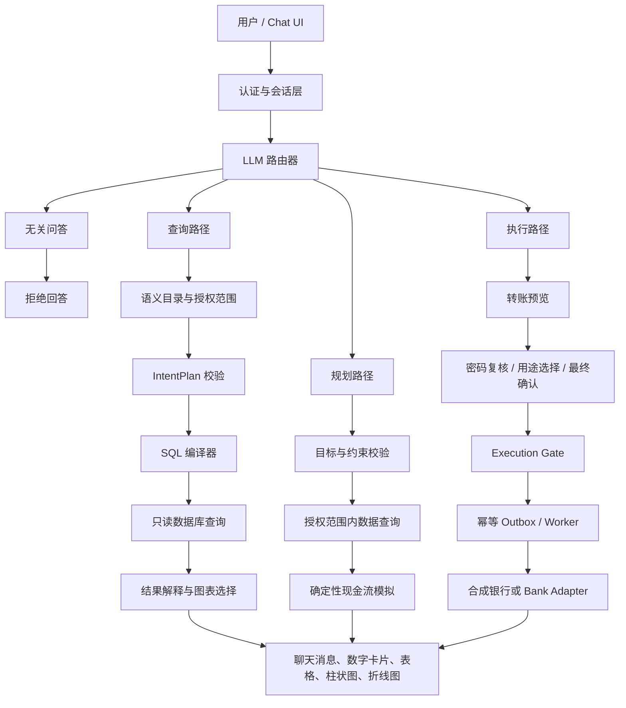

# FutureLedger 技术文档：系统架构、核心算法与安全设计

**项目：** FutureLedger（未来账本）  
**文档用途：** 比赛提交材料  
**版本：** 2026-11-01

## 1. 项目概述

FutureLedger 是一个面向个人用户的金融助手原型。用户通过自然语言查询账单、发起转账或制定存钱计划。系统先理解请求属于哪一类，再使用不同的处理路径：

- **查询类：** 将自然语言转换成受控的 IntentPlan，再由后端编译成只读 SQL。
- **执行类：** 生成转账预览，经过密码复核、用途选择和最终确认后才执行。
- **规划类：** 提取目标和约束，读取授权范围内的必要数据，再由确定性现金流引擎计算方案。
- **无关问答类：** 对与 FutureLedger 金融功能无关的问题拒绝回答，不访问账本或调用金融工具。

LLM 只负责语言理解和结构化计划，不直接编写 SQL、不直接修改账户余额，也不决定权限。

## 2. 总体系统架构



当前可运行的 Text2SQL Demo 使用 FastAPI、SQLite 合成账本和 LLM provider；银行侧 Role A、Execution Gate 和正式 Vue 前端已有接口契约、测试与部分实现，但不应被描述为已连接真实银行。

## 3. 技术分层

| 层 | 主要组件 | 职责 | 当前状态 |
|---|---|---|---|
|交互层|HTML 原型 / 目标 Vue 3 前端|登录、会话列表、聊天、结果卡片、确认卡|Demo 可运行；正式 Vue 前端待完成|
|API 层|FastAPI、Pydantic|鉴权、会话、请求校验、统一错误|Demo 已实现|
|路由与计划层|LLM Provider、Router、IntentPlan|识别查询/执行/规划/普通对话，输出 JSON 计划|Demo 已接入真实 LLM 配置|
|语义层|Semantic Catalog|定义指标、维度、枚举值、授权账户和日期口径|已实现 Demo 版本|
|SQL 层|SQL Compiler、SQL Audit|只从白名单生成参数化 SELECT|已实现|
|计算层|Ledger、Cashflow Simulator|金额汇总、趋势、逐日余额模拟|已实现合成数据版本|
|执行层|Execution Gate、Outbox、Worker|确认、强验证、额度、幂等和恢复|已实现模块与测试；生产接入待完成|
|银行适配层|Bank Adapter、Mock Bank|查询账户、收款人、流水和提交转账|合成银行接口与测试|
|存储层|SQLite Demo / PostgreSQL 设计|保存账本、会话、操作、审计|Demo 使用 SQLite；生产设计使用 PostgreSQL|

## 4. 查询流程与 IntentPlan

### 4.1 查询请求流程

1. 用户登录后创建 session；session 绑定用户主体、数据集版本和账户范围。
2. LLM 路由器只接收当前问题和必要的当前日期/用户上下文，判断是否为查询。
3. 查询模型输出结构化 IntentPlan，例如：

```json
{
  "kind": "aggregate",
  "dataset_id": "personal_ledger",
  "semantic_version": 1,
  "metric": "net_expense",
  "start": "2026-08-01",
  "end_exclusive": "2026-10-01",
  "filters": {"category": null, "merchant": null, "account_id": null},
  "group_by": "month",
  "series_by": "category",
  "sort": "date_asc",
  "limit": 100
}
```

4. Pydantic 校验字段、日期、指标和枚举值；后端覆盖模型不能控制的 `user_id`、账户范围和权限字段。
5. 业务校验缺失条件并触发澄清，例如“各类别排名前五”没有说明排名指标时先追问。
6. SQL 编译器根据固定指标表达式生成参数化只读 SQL。
7. 只读连接执行查询，后端根据结果选择 `metric_card`、`bar`、`line` 或 `table`。
8. 返回用户需要的金额、趋势或明细；不返回 IntentPlan、SQL、内部凭据或不属于当前用户的流水。

### 4.2 日期和“各项”理解

模型在 system prompt 中获得当前日期和日期规则。用户说“8 月和 9 月的各项净支出”时，模型应将其解释为连续区间 `[当年-08-01, 当年-10-01)`，并将“各项”映射为 `group_by=month`、`series_by=category`。最终是否接受仍由 schema 和后端校验决定，而不是由模型自由执行。

### 4.3 固定指标口径

- `gross_expense`：已入账、支出方向的消费金额。
- `refund`：已入账、收入方向的退款金额，按退款入账月份统计。
- `net_expense`：`gross_expense - refund`。
- `income`：已入账收入，不包含退款和账户内部互转。
- `transaction_count`：去重后的已入账交易数量。

金额统一以整数分保存和计算，避免浮点误差；月份按 Asia/Shanghai 的月初到下月月初解释。

## 5. 转账执行流程

执行类请求不会进入普通 SQL 查询路径，也不会让 LLM 直接修改账本。

```text
自然语言转账请求
  → 收款人/金额/账户补全
  → 转账预览
  → 用户确认参数与用途
  → 密码复核（必要时强验证）
  → 服务端重算风险等级与日额度
  → 生成稳定幂等键并写入操作/Outbox
  → Worker 提交 Bank Adapter
  → 查询最终状态
  → 成功、失败或 PENDING_UNKNOWN
```

每个操作绑定 `plan_version` 和 `params_hash`。参数变化会使旧确认失效；同一幂等键重复提交不会产生第二次扣款；银行响应丢失时保留 `PENDING_UNKNOWN`，先查证，不把未知状态当成失败重试。

当前本地演示转账只修改合成账本副本，不连接真实银行。生产设计要求只有银行角色能修改余额和事实账本。

## 6. 规划与现金流算法

规划请求例如“我想存 6000 元买电脑，至少留 3000 元”不使用 Text2SQL 直接生成计算结果。LLM 只提取目标金额、期限、最低保留余额、工资日等参数；后端查询所需的授权数据后，由确定性模拟器按日计算：

```text
daily_balance[t] = daily_balance[t-1]
                  + income[t]
                  - expense[t]
                  + transfer_in[t]
                  - transfer_out[t]
                  - planned_purchase[t]
```

模拟器输出预计达成日期、最低余额、最低余额日期、是否跌破保留金额、事件和假设。LLM 可以负责解释多个方案，但不能改变代码计算出的金额，也不会自动执行转账。

## 7. 数据与接口

主要数据域如下：

- **身份域：** users、sessions、messages。
- **银行事实域：** accounts、recipients、transactions、transfers、journal_entries、journal_lines。
- **语义域：** datasets、dataset_grants、指标和维度定义。
- **规划域：** goals、plans、plan_nodes、cashflow_events。
- **执行域：** operations、authorizations、quota_days、quota_reservations、outbox、audit_events。

关键接口包括：

|接口|用途|
|---|---|
|`POST /api/auth/register`、`/api/auth/login`|演示注册与登录|
|`POST /api/sessions`|创建绑定用户和数据集的会话|
|`POST /api/ask`|查询、路由、规划识别和转账预览|
|`GET /api/queries/{id}/export.csv`|当前 session 的结果导出|
|`POST /api/actions/{id}/authorize`|密码复核|
|`POST /api/actions/{id}/confirm`|选择用途并完成演示转账|
|`POST /api/plans/{id}/simulate`|运行确定性现金流模拟|
|`POST /api/operations/{id}/execute`|生产设计中的执行门提交接口|

## 8. 安全设计

1. **最小权限：** LLM 只能得到当前用户授权范围内的有限上下文；SQL 执行使用只读连接。
2. **主体绑定：** 用户身份由服务端 session/token 确定，模型和请求体不能传入另一个 `user_id` 来扩大范围。
3. **SQL 白名单：** 只允许注册指标、维度、表和关联；禁止 `INSERT`、`UPDATE`、`DELETE`、DDL、多语句和危险函数。
4. **参数绑定：** 用户日期、类别、商户和账户作为参数绑定，不拼接进 SQL 文本。
5. **写读分离：** 查询路径不具备写权限；转账必须经过独立执行门、密码复核、参数哈希和幂等控制。
6. **敏感信息最小化：** 不把密码、API key、完整流水和内部 ID 发给模型；回答中隐藏 SQL 和内部凭据。
7. **审计与恢复：** 操作、状态变化、请求 ID 和银行引用可追加记录；未知银行结果必须进入查证流程。

生产部署还应启用 PostgreSQL RLS、独立数据库角色、TLS、MFA、密钥管理服务、容器资源限制和无网络分析沙箱。当前 Demo 不应被当作生产银行系统。

## 9. 当前边界

仓库使用的是合成账单和本地演示认证；尚未连接真实银行，也没有生产级身份系统。正式 Vue 手机端、跨进程未知状态恢复、生产部署沙箱和完整 RLS 仍属于后续工作。比赛演示应明确说明这些边界。

